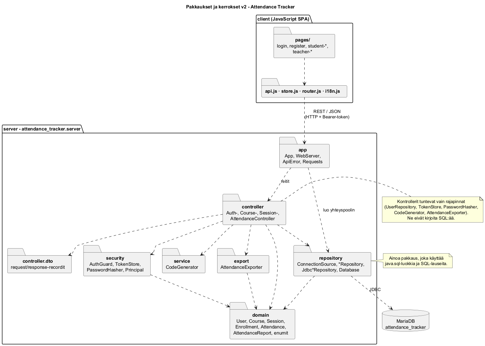
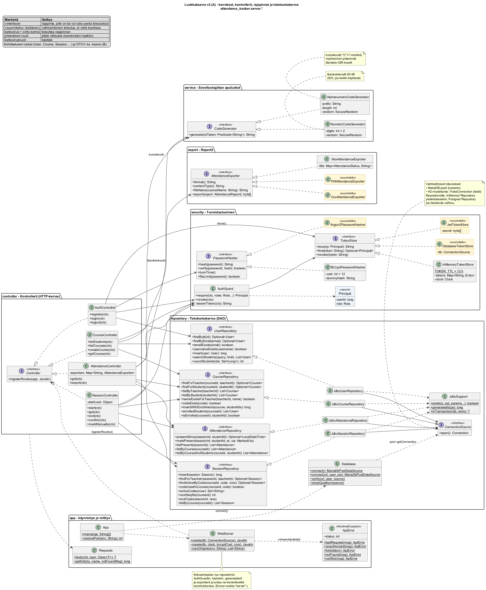
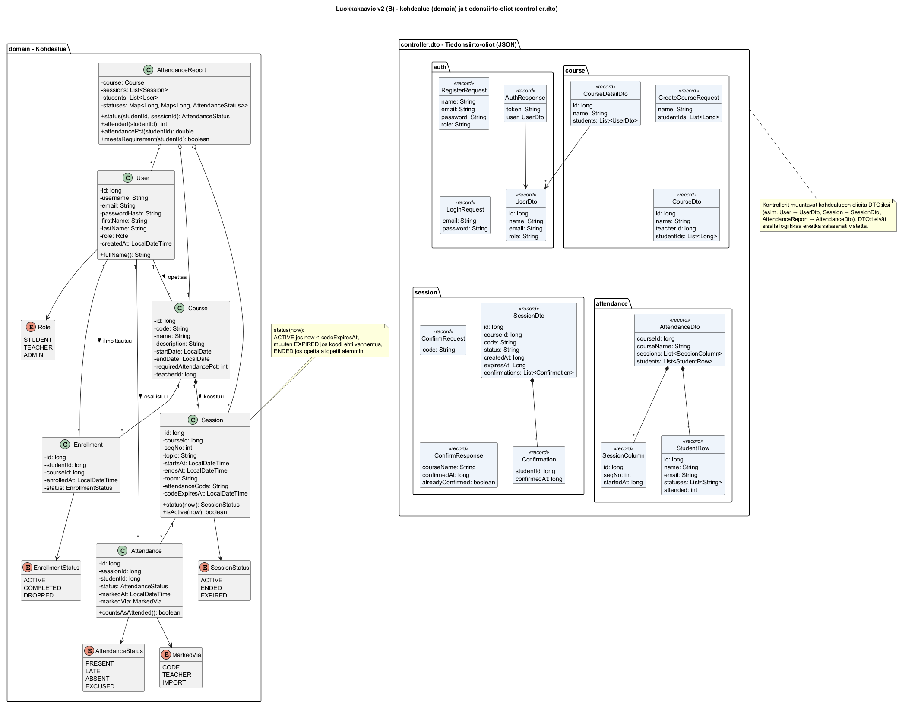

# Luokkakaavio v2 – Attendance Tracker

Tässä dokumentissa luokkakaavio päivitetään versioon 2. Kaavio kuvaa ohjelmistotuotteen nykyistä suunnitelmaa: luokat on jaettu pakkauksiin, vaihdettaville osille on suunniteltu rajapinnat, ja kontrollerit on erotettu tietokantakommunikoinnista.

| Tiedosto | Sisältö |
|---|---|
| `pakkauskaavio_v2.png` / `.puml` | Yleiskuva pakkauksista, kerroksista ja niiden riippuvuuksista |
| `luokkakaavio_v2_A_kerrokset.png` / `.puml` | Kontrollerit, tunnistautuminen, palvelut, raportit, tietokantakerros ja rajapinnat metodeineen |
| `luokkakaavio_v2_B_kohdealue.png` / `.puml` | Kohdealueen luokat ja tiedonsiirto-oliot (DTO) |

Kaaviot on piirretty PlantUML:llä. `.puml`-tiedostoja muokkaamalla kaaviot pysyvät ajan tasalla, ja ne piirretään uudelleen komennolla `java -jar plantuml.jar -tpng *.puml`.

---

## 1. Muutokset versioon 1 verrattuna

| v1 | v2 | Miksi |
|---|---|---|
| Kaksi pakkausta: *Kontrollerit* ja *Kohdealue* | Kahdeksan pakkausta: `app`, `controller`, `controller.dto`, `security`, `service`, `export`, `repository`, `domain` | Jokaisella pakkauksella on yksi vastuu, ja riippuvuudet kulkevat vain alaspäin |
| `Database` kuului kontrollereihin, ja jokainen API-luokka käytti sitä suoraan | Oma tietokantakerros (`repository`), jossa on rajapinta jokaiselle taululle tai koosteelle | Kontrollerit eivät enää sisällä SQL:ää |
| `Auth` ja `Passwords` olivat konkreettisia luokkia | `TokenStore`- ja `PasswordHasher`-rajapinnat sekä `AuthGuard` | Tokenien tallennus ja tiivistealgoritmi voidaan vaihtaa |
| Excel-vienti oli kovakoodattu `AttendanceApi`:in | `AttendanceExporter`-rajapinta ja `XlsxAttendanceExporter` | CSV- ja PDF-vienti voidaan lisätä koskematta kontrolleriin |
| Koodien arpominen oli kontrollerien sisällä | `CodeGenerator`-rajapinta | Läsnäolokoodin muoto (2 numeroa, myöhemmin pidempi tai QR) vaihdettavissa |
| Kohdealueen luokissa oli v1-skeeman kentät | Kentät vastaavat `attendance_tracker_v2.sql`-skeemaa (esim. `firstName`/`lastName`, `topic`, `room`, `MarkedVia`, `EnrollmentStatus`) | Kaavio vastaa tietokantaa |
| Ei DTO-luokkia | `controller.dto`-pakkaus: kaikki JSON-pyynnöt ja -vastaukset (Java recordeja) | Rajapinta frontendiin on dokumentoitu, eikä salasanatiiviste vuoda vastauksiin |
| `Session.isOpen()` | `Session.status(now)` → `ACTIVE`/`ENDED`/`EXPIRED`; `AttendanceReport` laskee läsnäoloprosentin | Liiketoimintasäännöt ovat kohdealueessa, eivät SQL-kyselyjen välissä |
| – | `Controller.registerRoutes(app)` | Jokainen kontrolleri rekisteröi omat reittinsä, joten `WebServer` ei tunne URL-polkuja |

---

## 2. Pakkaukset

Juuripakkaus on `attendance_tracker.server`.

| Pakkaus | Vastuu | Saa riippua |
|---|---|---|
| `app` | Käynnistys (`App`), Javalin-palvelimen konfigurointi ja olioiden kokoaminen (`WebServer`), virheiden muunto HTTP-vastauksiksi (`ApiError`), pyynnön apufunktiot (`Requests`) | kaikista (kokoamispiste) |
| `controller` | HTTP-kerros: lukee pyynnön, tarkistaa roolin, kutsuu repositorioita ja palveluita ja palauttaa DTO:n | `dto`, `security`, `service`, `export`, `repository` (vain rajapinnat), `domain` |
| `controller.dto` | Pyyntö- ja vastausrecordit (JSON) | – |
| `security` | Kirjautumistokenit, roolitarkistus, salasanojen tiivistys | `domain` |
| `service` | Logiikan apuluokat, joita usea kontrolleri käyttää (koodien generointi) | – |
| `export` | Läsnäoloraportin vienti tiedostoksi | `domain` |
| `repository` | Kaikki tietokantakommunikointi (JDBC, SQL) | `domain` |
| `domain` | Kohdealueen oliot ja niiden säännöt | – |

Riippuvuudet kulkevat ylhäältä alas (`app → controller → security/service/export/repository → domain`). Kehiä ei ole: `domain` ei tunne muita pakkauksia, eikä `repository` tunne kontrollereita.

---

## 3. Rajapinnat ja niiden metodit

Rajapinta on suunniteltu jokaiselle luokalle, jolle on jo nyt tai voi myöhemmin tulla vaihtoehtoinen toteutus. Kaaviossa keltaiset luokat (`<<suunniteltu>>`) ovat mahdollisia tulevia toteutuksia.

### 3.1 `repository.ConnectionSource`
Antaa JDBC-yhteyden. Rajapinta on jo koodissa (`Database.ConnectionSource`).

| Metodi | Kuvaus |
|---|---|
| `open(): Connection` | Lainaa yhteyden; kutsuja sulkee sen (palautuu pooliin) |

Toteutukset: MariaDB-pooli (`Database.connect()` → `pool::getConnection`), testeissä H2-muistikanta ja `FakeConnection`.

### 3.2 Repositoriorajapinnat (`repository`)
Jokaisella rajapinnalla on nyt `Jdbc…Repository`-toteutus. Yksikkötesteihin voi tehdä `InMemory…Repository`-toteutukset ja tietokannan vaihtuessa esim. `Postgres…Repository`-toteutukset.

**`UserRepository`**

| Metodi | Kuvaus |
|---|---|
| `findById(id): Optional<User>` | Käyttäjä id:n perusteella |
| `findByEmail(email): Optional<User>` | Kirjautuminen |
| `emailExists(email): boolean` | Rekisteröinnin tarkistus |
| `usernameExists(username): boolean` | Uniikin käyttäjänimen johtaminen sähköpostista |
| `insert(user): long` | Uusi käyttäjä, palauttaa id:n |
| `searchStudents(query, limit): List<User>` | Opettajan opiskelijahaku (nimi/sähköposti, enintään 50) |
| `countStudents(ids): int` | Tarkistaa, että kurssille valitut opiskelijat ovat olemassa |

**`CourseRepository`** (kurssit ja niiden ilmoittautumiset)

| Metodi | Kuvaus |
|---|---|
| `findForTeacher(courseId, teacherId): Optional<Course>` | Kurssi vain, jos opettaja omistaa sen (muuten 404) |
| `findForStudent(courseId, studentId): Optional<Course>` | Kurssi vain, jos opiskelija on aktiivisesti ilmoittautunut |
| `listByTeacher(teacherId): List<Course>` | Opettajan kurssit |
| `listByStudent(studentId): List<Course>` | Opiskelijan kurssit |
| `nameExistsForTeacher(teacherId, name): boolean` | Saman nimisen kurssin esto |
| `codeExists(code): boolean` | Kurssikoodin uniikkius |
| `insertWithEnrollments(course, studentIds): long` | Kurssi ja ilmoittautumiset yhdessä transaktiossa |
| `enrolledStudents(courseId): List<User>` | Aktiiviset opiskelijat nimen mukaan järjestettynä |
| `isEnrolled(courseId, studentId): boolean` | Manuaalisen merkinnän tarkistus |

**`SessionRepository`** (oppitunnit ja läsnäolokoodit)

| Metodi | Kuvaus |
|---|---|
| `insert(session): long` | Uusi oppitunti |
| `findForTeacher(sessionId, teacherId): Optional<Session>` | Oppitunti vain kurssin opettajalle |
| `findActiveByCode(courseId, code, now): Optional<Session>` | Opiskelijan koodilla aktiivinen oppitunti |
| `codeUsedInCourse(courseId, code): boolean` | Erottaa vanhentuneen koodin väärästä koodista |
| `activeCodes(now): Set<String>` | Käytössä olevat koodit (uuden koodin arpomiseen) |
| `nextSeqNo(courseId): int` | Seuraava järjestysnumero |
| `endCode(sessionId, now)` | Lopettaa koodin voimassaolon heti |
| `listByCourse(courseId): List<Session>` | Raportin sarakkeet |

**`AttendanceRepository`**

| Metodi | Kuvaus |
|---|---|
| `presentSince(sessionId, studentId): Optional<LocalDateTime>` | Milloin opiskelija merkittiin läsnäolevaksi |
| `markPresent(sessionId, studentId, at, via)` | Lisää PRESENT-rivin tai päivittää olemassa olevan (`via` = CODE / TEACHER / IMPORT) |
| `listPresent(sessionId): List<Attendance>` | Opettajan näkymän vahvistukset |
| `listByCourse(courseId): List<Attendance>` | Koko kurssin raportti (opettaja) |
| `listByCourseAndStudent(courseId, studentId): List<Attendance>` | Opiskelijan oma rivi |

### 3.3 `security.TokenStore`

| Metodi | Kuvaus |
|---|---|
| `issue(p: Principal): String` | Luo tokenin kirjautuneelle käyttäjälle |
| `find(token): Optional<Principal>` | Palauttaa tokenin omistajan, jos token on voimassa |
| `revoke(token)` | Uloskirjautuminen |

Toteutukset: `InMemoryTokenStore` (nykyinen `Auth`, 12 h voimassaolo, häviää uudelleenkäynnistyksessä); suunnitteilla `DatabaseTokenStore` (tokenit säilyvät uudelleenkäynnistyksen yli) ja `JwtTokenStore` (tilaton, useampi palvelininstanssi).
`AuthGuard` on konkreettinen luokka: se lukee `Authorization: Bearer`-otsakkeen, hakee käyttäjän `TokenStore`sta ja tarkistaa roolin (`require(ctx, Role...)` → 401/403).

### 3.4 `security.PasswordHasher`

| Metodi | Kuvaus |
|---|---|
| `hash(password): String` | Tiivisteen luonti rekisteröinnissä |
| `verify(password, hash): boolean` | Kirjautumisen tarkistus |
| `burnTime()` | Kuluttaa yhtä paljon aikaa kuin `verify`, jos sähköpostia ei löydy (ajoitushyökkäyksen esto) |
| `fitsLimit(password): boolean` | Algoritmin pituusraja (bcrypt: 72 tavua) |

Toteutukset: `BCryptPasswordHasher` (nykyinen `Passwords`, cost 12); suunnitteilla `Argon2PasswordHasher`.

### 3.5 `service.CodeGenerator`

| Metodi | Kuvaus |
|---|---|
| `generate(isTaken: Predicate<String>): String` | Arpoo koodin, joka ei ole käytössä |

Toteutukset: `NumericCodeGenerator` (läsnäolokoodit 00–99; palauttaa 503, jos kaikki ovat käytössä) ja `AlphanumericCodeGenerator` (kurssikoodit `C` + 7 merkkiä; sopii myöhemmin myös pidemmille läsnäolo- tai QR-koodeille).

### 3.6 `export.AttendanceExporter`

| Metodi | Kuvaus |
|---|---|
| `format(): String` | Tunniste, esim. `xlsx` (valitaan `?format=`-parametrilla) |
| `contentType(): String` | HTTP Content-Type |
| `fileName(courseName): String` | ASCII-turvallinen tiedostonimi |
| `export(report: AttendanceReport): byte[]` | Tuottaa tiedoston |

Toteutukset: `XlsxAttendanceExporter` (nykyinen fastexcel-toteutus); suunnitteilla `CsvAttendanceExporter` ja `PdfAttendanceExporter`. `AttendanceController` saa exportterit `Map<String, AttendanceExporter>`-muodossa, joten uuden muodon lisääminen ei muuta kontrolleria.

### 3.7 `controller.Controller`

| Metodi | Kuvaus |
|---|---|
| `registerRoutes(app: Javalin)` | Kontrolleri rekisteröi omat reittinsä |

`WebServer` käy kontrollerit läpi ja kutsuu jokaiselle `registerRoutes`, joten uusi kontrolleri lisätään yhdellä rivillä.

---

## 4. Kohdealue ja tiedonsiirto-oliot

- Kohdealueen luokat vastaavat tauluja `users`, `courses`, `enrollments`, `sessions` ja `attendances`. Kaikki tilakentät on mallinnettu enumeina (`Role`, `EnrollmentStatus`, `SessionStatus`, `AttendanceStatus`, `MarkedVia`).
- Säännöt ovat olioissa: `Session.status(now)` päättelee oppitunnin tilan, `Attendance.countsAsAttended()` kertoo, lasketaanko merkintä läsnäoloksi (PRESENT/LATE), ja `AttendanceReport` laskee läsnäolon ja vertaa sitä kurssin vaatimukseen (`meetsRequirement`).
- DTO:t on ryhmitelty käyttötapauksen mukaan (auth, course, session, attendance). Ne ovat frontendin ja palvelimen välinen sopimus, ja niiden kentät vastaavat `client/js/api.js`:n odottamaa JSONia.

---

## 5. Modularisoinnin tarkistus

### 5.1 Nykytila koodissa
Tarkistettu kansio: `server/src/main/java/attendance_tracker/server/`.

**Hyvää:**
- Kontrollerit on jo jaettu resurssin mukaan (`AuthApi`, `CourseApi`, `SessionApi`, `AttendanceApi`), ja ne saavat riippuvuutensa konstruktorissa (`ConnectionSource`, `Auth`, `Passwords`, `Clock`).
- Tietokantayhteys on jo rajapinnan takana (`Database.ConnectionSource`), ja testit käyttävät sen tilalla H2:ta tai `FakeConnection`ia.
- `Clock` injektoidaan, joten aikariippuvaa logiikkaa voi testata.
- Virheet käsitellään keskitetysti (`ApiError` ja `app.exception(...)`).

**Ongelmat:**
1. **SQL on kontrollereissa.** Kaikki 4 API-luokkaa avaavat yhteyden ja kirjoittavat SQL:n itse. Esimerkiksi `SessionApi` (324 riviä) sisältää HTTP-käsittelyn, koodin arpomisen, tilalogiikan ja 12 SQL-lausetta.
2. **Kontrollerit kutsuvat toistensa staattisia metodeja.** `SessionApi` ja `AttendanceApi` kutsuvat `CourseApi.teacherCourseName`-, `studentCourseName`- ja `enrolledStudents`-metodeja. `CourseApi` ja `SessionApi` taas kutsuvat `AuthApi.exists`-, `generatedId`- ja `userFrom`-metodeja. Kontrollerit ovat siis kytkeytyneet toisiinsa tietokantakoodin kautta.
3. **Liiketoimintasäännöt ovat SQL:n seassa.** Oppitunnin tila lasketaan `SessionApi.loadSession`issa ja läsnäolon laskenta on `AttendanceApi`:n yksityisessä `Report`-recordissa, joten niitä ei voi käyttää muualla.
4. **Vaihdettavat osat ovat konkreettisia luokkia.** `Auth` ja `Passwords` eivät ole rajapintojen takana, ja Excel-vienti on `AttendanceApi`:n sisällä.
5. **Kaikki on yhdessä pakkauksessa,** ja luokka `server` (pieni alkukirjain) sekä rekisteröi kaikki reitit että sisältää kaikkien kontrollerien käyttämät apumetodit `body` ja `pathId`.

### 5.2 Tavoitetila (v2)
**Kontrollerit:**
- Kontrolleri tekee vain HTTP-työn: lukee parametrit ja rungon (`Requests`), tarkistaa roolin (`AuthGuard`), kutsuu repositorioita ja palveluita, muuntaa tuloksen DTO:ksi ja asettaa statuskoodin.
- Kontrolleri riippuu vain rajapinnoista, eikä yksikään kontrolleri kutsu toista kontrolleria.
- Jokainen kontrolleri rekisteröi omat reittinsä (`Controller.registerRoutes`).

Kontrollerien riippuvuudet:

| Kontrolleri | Riippuvuudet |
|---|---|
| `AuthController` | `UserRepository`, `PasswordHasher`, `TokenStore`, `AuthGuard` |
| `CourseController` | `CourseRepository`, `UserRepository`, `CodeGenerator` (kurssikoodi), `AuthGuard`, `Clock` |
| `SessionController` | `SessionRepository`, `CourseRepository`, `AttendanceRepository`, `CodeGenerator` (läsnäolokoodi), `AuthGuard`, `Clock` |
| `AttendanceController` | `CourseRepository`, `SessionRepository`, `AttendanceRepository`, `AttendanceExporter`it, `AuthGuard` |

**Tietokantakommunikointi:**
- `repository` on ainoa pakkaus, joka käyttää `java.sql`-luokkia. Repositorio palauttaa kohdealueen olioita, ei `ResultSet`iä eikä DTO:ita.
- Jako on taulun tai koosteen mukaan: `User`, `Course` (+ `Enrollment`), `Session` ja `Attendance`.
- Yhteiset JDBC-apumetodit (`exists`, `generatedId`, `inTransaction`) siirtyvät `JdbcSupport`-luokkaan `AuthApi`:sta.
- Transaktiot pysyvät repositoriossa: `insertWithEnrollments` lisää kurssin ja ilmoittautumiset yhdessä transaktiossa (nykyinen `CourseApi.createCourse`-logiikka).
- `WebServer` kokoaa kaiken: `new JdbcCourseRepository(db)` jne., ja testit voivat antaa tilalle muistinvaraiset toteutukset.

### 5.3 Refaktorointijärjestys
1. Siirrä luokat pakkauksiin ja nimeä ne uudelleen (`server` → `WebServer`, `*Api` → `*Controller`, `Auth` → `InMemoryTokenStore` + `AuthGuard`, `Passwords` → `BCryptPasswordHasher`). Toimintaa ei muuteta, ja nykyiset testit varmistavat sen.
2. Tee rajapinnat `TokenStore`, `PasswordHasher`, `CodeGenerator` ja `AttendanceExporter` ja siirrä Excel-vienti `XlsxAttendanceExporter`iin.
3. Siirrä SQL kontrollereista `Jdbc…Repository`-luokkiin repositorio kerrallaan: ensin `CourseRepository`, koska sen staattisia metodeja kutsutaan kahdesta muusta kontrollerista.
4. Siirrä tilalogiikka kohdealueeseen (`Session.status`, `AttendanceReport`).
5. Lisää `Controller.registerRoutes` ja poista reittilista `WebServer`istä.
