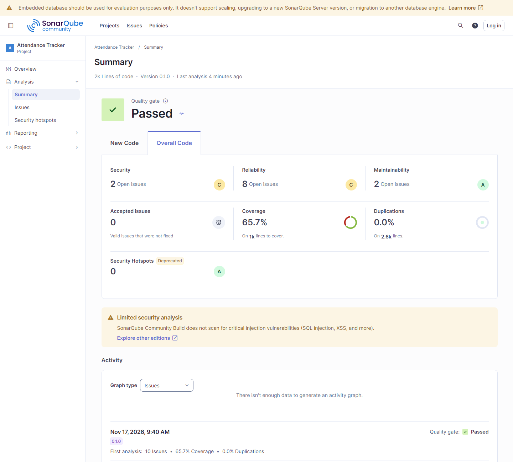
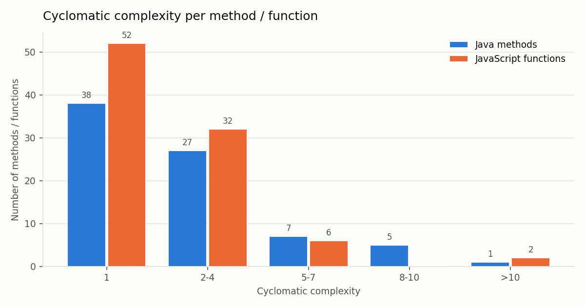
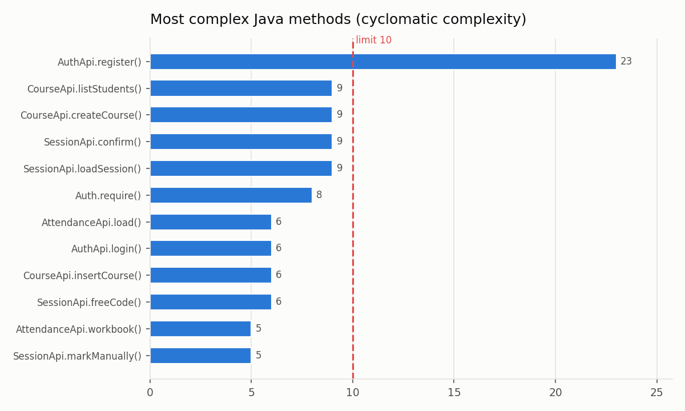
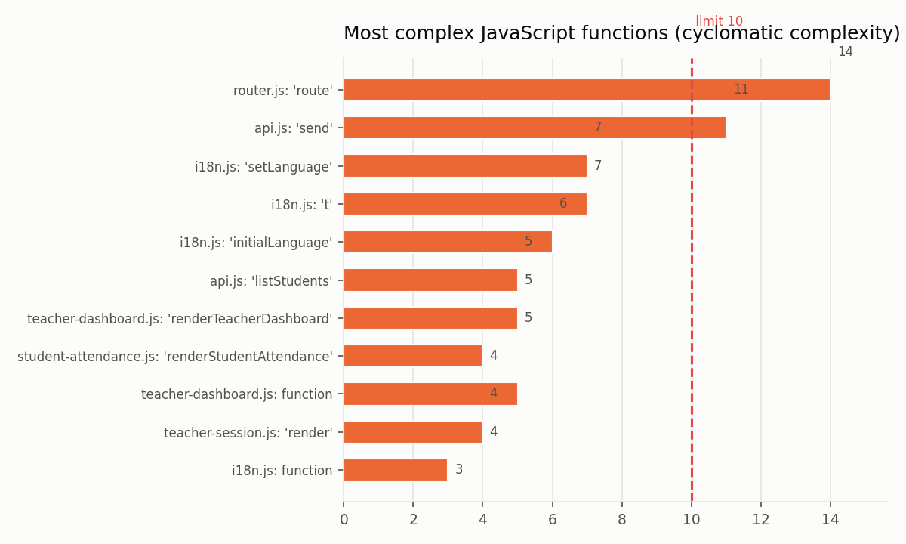
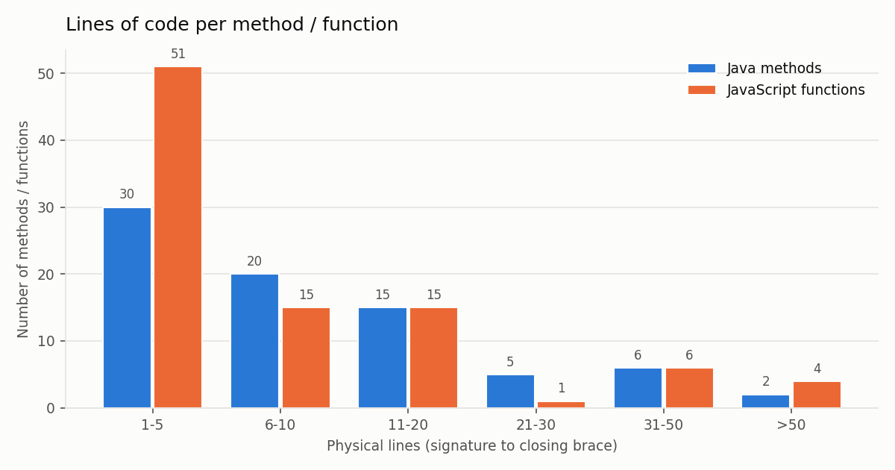
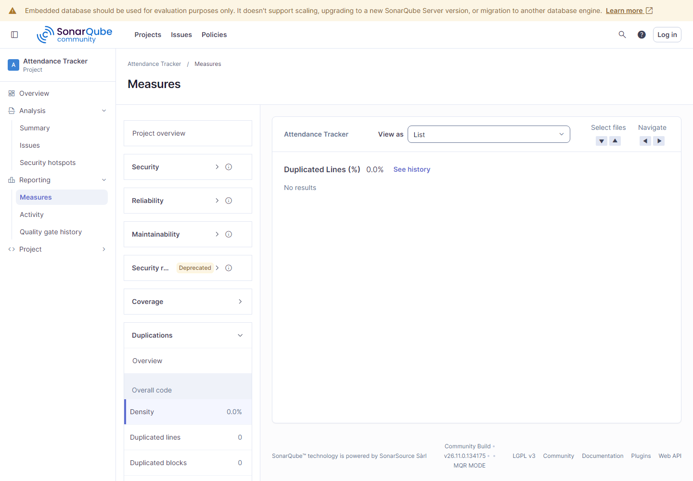
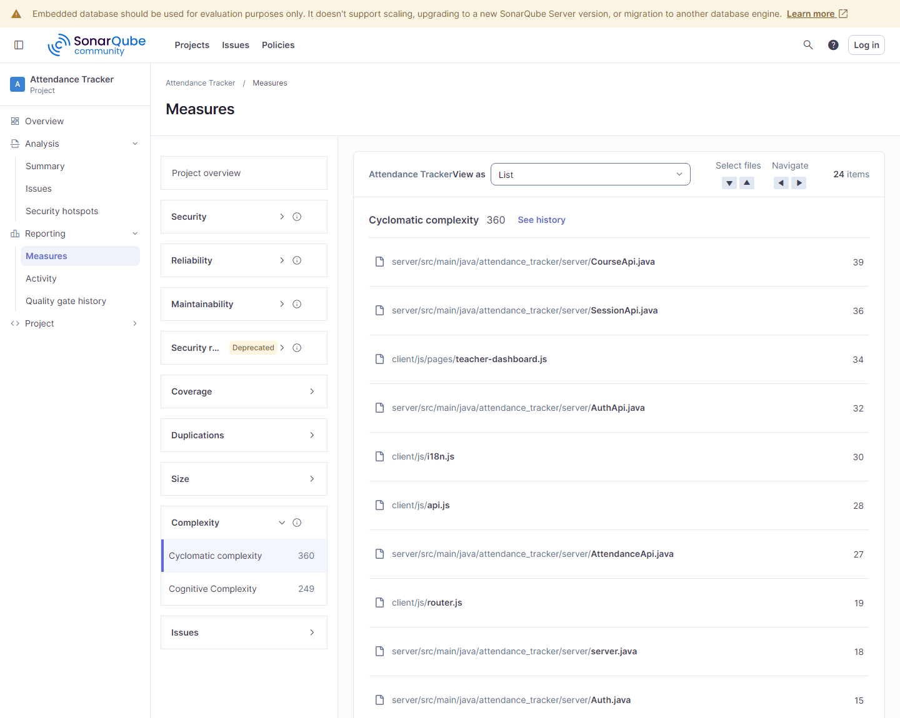
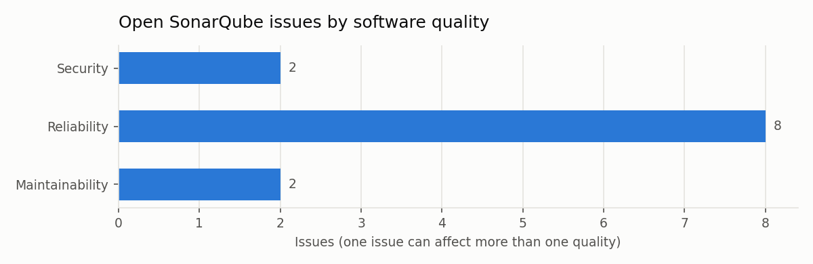
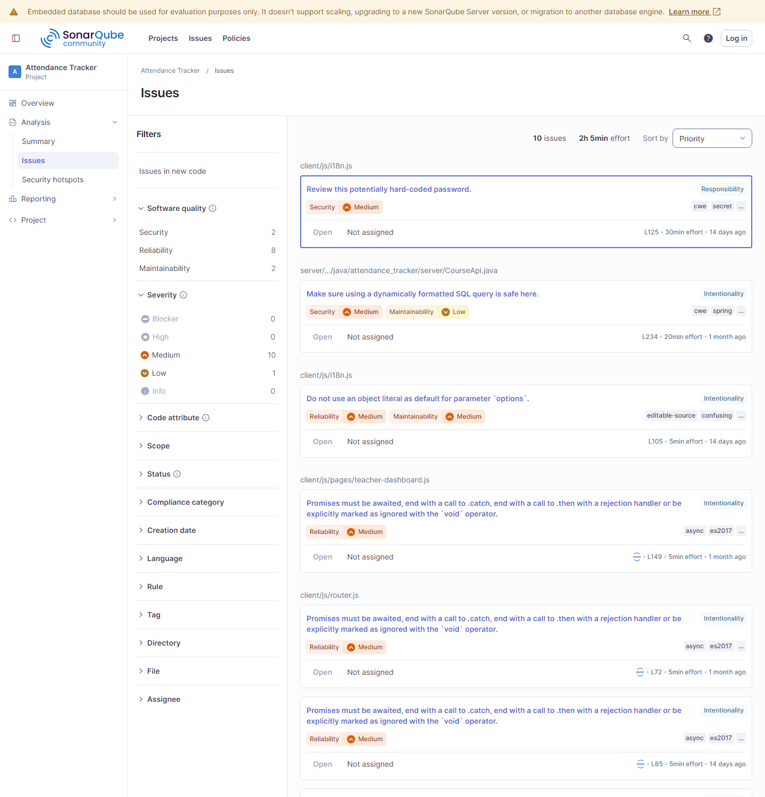

# Statistical Code Review Report

Sprint 6, task 2 (static code analysis). Analysis date: 17 Nov 2026, commit `8b761b0` (`master`).

This report records the static analysis of the Attendance Tracker code base: the tools and settings
we used, the metrics they produced, how we read the results, and which problems the clean-up and
refactoring task (Sprint 6, task 3) should fix first.

**Contents:**
[1. Scope](#1-scope) ·
[2. Tools and method](#2-tools-and-method) ·
[3. Summary metrics](#3-summary-metrics) ·
[4. Code metrics](#4-code-metrics) ·
[5. SonarQube issues](#5-sonarqube-issues) ·
[6. High-priority issues and recommendations](#6-high-priority-issues-and-recommendations) ·
[7. Limitations](#7-limitations) ·
[8. Reproducing the analysis](#8-reproducing-the-analysis) ·
[9. Files in this folder](#9-files-in-this-folder)

---

## 1. Scope

| Part | Path | Language | Files | Lines of code (ncloc) |
| --- | --- | --- | ---: | ---: |
| Backend (REST API) | `server/src/main/java` | Java 21 | 10 | 1,144 |
| Frontend (SPA) | `client/js` | JavaScript (ES modules) | 14 | 901 |
| **Total analysed** | | | **24** | **2,045** |

Unit tests (`server/src/test/java`) were analysed as test code. They are not counted in the issue
and size metrics, but they provide the coverage figures. Generated files (`client/css/output.css`)
and third-party code are excluded.

## 2. Tools and method

| Tool | Version | What we used it for |
| --- | --- | --- |
| **SonarQube** Community Build | 26.11 (Docker image `sonarqube:community`) | Analysis server: issues (bugs, vulnerabilities, code smells), security hotspots, duplication, file-level complexity, quality gate. Default *Sonar way* profiles: 263 Java rules, 200 JavaScript rules. |
| **SonarScanner** CLI | Docker image `sonarsource/sonar-scanner-cli` | Sends the sources, compiled classes, JaCoCo coverage and JUnit results to SonarQube. Configured in [`sonar-project.properties`](../../sonar-project.properties). |
| **PMD** | 7.29.0 (via `maven-pmd-plugin` 3.28.0) | Per-method cyclomatic complexity, cognitive complexity and NCSS for Java. Ruleset: [`server/config/pmd-metrics.xml`](../../server/config/pmd-metrics.xml). |
| **PMD CPD** | 7.29.0 | Copy-paste detection for Java (minimum 50 tokens). |
| **ESLint** | 9.39.1 | Per-function cyclomatic complexity, statement count and length for JavaScript. Config: [`scripts/eslint-metrics.config.js`](scripts/eslint-metrics.config.js). |
| **JaCoCo** | 0.8.13 | Line and branch coverage of the Java tests (already part of `./mvnw verify`). |

SonarQube reports complexity per file, not per method. We therefore ran PMD (Java) and ESLint
(JavaScript) with every threshold set to 1. In that mode they report a value for *every* method,
not only those over a limit, and [`scripts/collect_metrics.py`](scripts/collect_metrics.py) turns
the reports into the tables and charts below. "Lines of code per method" means physical lines from
the method signature to its closing brace, so comments and blank lines inside a method count.

**Thresholds used to judge the results:**

| Metric | Limit | Source |
| --- | --- | --- |
| Cyclomatic complexity per method | ≤ 10 | McCabe's original limit; default of PMD `CyclomaticComplexity` and Sonar `S1541` |
| Cognitive complexity per method | ≤ 15 | Sonar way rule `S3776` |
| Lines per method | ≤ 30 | Team convention for this review (fits on one screen) |
| Duplicated lines | < 3 % | Sonar way quality gate |

## 3. Summary metrics



| Metric | Value | Assessment |
| --- | ---: | --- |
| Quality gate (Sonar way) | **Passed** | ✅ |
| Lines of code (ncloc) | 2,045 (Java 1,144 / JS 901) | Small code base |
| Methods / functions | 170 (Java 78 / JS 92) | |
| Classes | 29 (incl. records) | |
| Cyclomatic complexity, total | 360 (Java 193 / JS 167) | |
| Cognitive complexity, total | 249 | |
| Bugs | 5 | Reliability rating **C** |
| Vulnerabilities | 2 (both reviewed: false positive / safe, see §5) | Security rating **C** until marked in SonarQube |
| Code smells | 3 | Maintainability rating **A** |
| Security hotspots | 0 | **A** |
| Technical debt | 45 min (maintainability), 2 h 5 min for all 10 issues | Debt ratio 0.1 % |
| Duplicated lines | **0.0 %** (0 blocks) | ✅ |
| Unreachable / unused code | 0 findings | ✅ |
| Comment density | 9.0 % | Low on the backend (3.8–7.7 % per file) |
| Unit tests | 59, 100 % passing | ✅ |
| Coverage, Java only (JaCoCo) | 93.0 % lines, 88.0 % branches | ✅ above the 75 % build limit |
| Coverage, whole project (SonarQube) | 65.7 % | Lower because the frontend has no automated tests (0 %) |

Raw values: [`data/sonar-project-measures.json`](data/sonar-project-measures.json),
[`data/summary.json`](data/summary.json).

## 4. Code metrics

### 4.1 Cyclomatic complexity

| | Methods | Mean | Median | 90th percentile | Max | Over limit (> 10) |
| --- | ---: | ---: | ---: | ---: | ---: | ---: |
| Java | 78 | 2.77 | 2 | 6 | **23** | **1** |
| JavaScript | 92 | 2.09 | 1 | 4 | **14** | **2** |
| Java cognitive complexity | 78 | 1.60 | 1 | 5 | 14 | 0 (limit 15) |



Most of the code is simple: 83 % of Java methods and 91 % of JavaScript functions have a
complexity of 1–4. The complexity is concentrated in a few methods:





**Top 10 Java methods by cyclomatic complexity**

| Method | Cyclomatic | Cognitive | NCSS | Lines |
| --- | ---: | ---: | ---: | ---: |
| `AuthApi.register` | **23** | 14 | 38 | 53 |
| `CourseApi.listStudents` | 9 | 8 | 26 | 37 |
| `CourseApi.createCourse` | 9 | 5 | 20 | 28 |
| `SessionApi.confirm` | 9 | 7 | 30 | 44 |
| `SessionApi.loadSession` | 9 | 8 | 34 | 46 |
| `Auth.require` | 8 | 6 | 10 | 14 |
| `AttendanceApi.load` | 6 | 6 | 29 | 46 |
| `AuthApi.login` | 6 | 3 | 17 | 22 |
| `CourseApi.insertCourse` | 6 | 3 | 26 | 34 |
| `SessionApi.freeCode` | 6 | 5 | 15 | 23 |

**JavaScript functions over the limit**

| Function | Cyclomatic | Statements | Lines |
| --- | ---: | ---: | ---: |
| `route` (`js/router.js`) | **14** | 18 | 30 |
| `send` (`js/api.js`) | **11** | 17 | 34 |

**Interpretation.** `AuthApi.register` is the only Java method over the limit, and by a wide margin.
It validates five input fields one after another, and each `x == null ? "" : x` default, `||`
condition and `if` adds a path. Its cognitive complexity (14) stays just under Sonar's limit of 15
because the code is flat (no nesting), which is why SonarQube itself raised no issue for it. It is
still the hardest method in the backend to test exhaustively. In the frontend, `route` mixes three
redirect rules, cleanup and rendering, and `send` handles every HTTP error case in one function.
The four methods at 9 (`listStudents`, `createCourse`, `confirm`, `loadSession`) are close to the
limit and are the next candidates.

### 4.2 Lines of code per method

| | Methods | Mean | Median | 90th percentile | Max | Over limit (> 30 lines) |
| --- | ---: | ---: | ---: | ---: | ---: | ---: |
| Java | 78 | 12.5 | 6.5 | 30 | **61** | **8** |
| JavaScript | 92 | 13.2 | 4 | 30 | **176** | **10** |



**Java methods over 30 lines**

| Method | Lines | Cyclomatic |
| --- | ---: | ---: |
| `server.create` | 61 | 1 |
| `AuthApi.register` | 53 | 23 |
| `AttendanceApi.load` | 46 | 6 |
| `AttendanceApi.workbook` | 46 | 5 |
| `SessionApi.loadSession` | 46 | 9 |
| `SessionApi.confirm` | 44 | 9 |
| `CourseApi.listStudents` | 37 | 9 |
| `CourseApi.insertCourse` | 34 | 6 |

**JavaScript functions over 30 lines**

| Function | File | Lines | Cyclomatic |
| --- | --- | ---: | ---: |
| `renderTeacherDashboard` | `js/pages/teacher-dashboard.js` | **176** | 5 |
| `renderTeacherAttendance` | `js/pages/teacher-attendance.js` | **117** | 3 |
| `renderTeacherSession` | `js/pages/teacher-session.js` | **102** | 1 |
| `renderRegister` | `js/pages/register.js` | 55 | 1 |
| `renderStudentAttendance` | `js/pages/student-attendance.js` | 49 | 4 |
| `renderConfirm` | `js/pages/student-confirm.js` | 46 | 2 |
| `render` | `js/pages/teacher-session.js` | 42 | 4 |
| `renderLogin` | `js/pages/login.js` | 37 | 1 |
| `send` | `js/api.js` | 34 | 11 |
| `renderStudentDashboard` | `js/pages/student-dashboard.js` | 31 | 2 |

**Interpretation.** Length and complexity are two separate problems here. `server.create` (61 lines)
has a complexity of 1: it only registers routes and is easy to read, so it is long but low risk.
The frontend page functions are the real outliers. Each page is one big `render…` function that
builds the HTML template, attaches every event listener and contains the event handlers as nested
closures. `renderTeacherDashboard` is 176 lines with 32 statements. These functions are not complex
by branch count, but they are hard to read and to change safely, and they cannot be unit tested in
parts.

### 4.3 Duplicate and unreachable code

| Check | Tool | Result |
| --- | --- | --- |
| Duplicated blocks, whole project | SonarQube CPD | **0 blocks, 0 lines (0.0 %)** |
| Duplicated code, Java (≥ 50 tokens) | PMD CPD | **0 duplications** ([`data/cpd.xml`](data/cpd.xml)) |
| Unreachable code (`S1763`), dead stores (`S1854`), unused private methods/fields (`S1144`, `S1068`), unused imports/variables (`S1128`, `S1481`) | SonarQube Sonar way | **0 issues** |



There is no copy-pasted code above the detection thresholds. Shared logic is already factored out:
`server.body` and `server.pathId` for request parsing, `AuthApi.exists` and `AuthApi.generatedId`
for common queries, and `api.js`'s single `send` for every HTTP call. During manual review we found
one small piece of near-duplication below the threshold. The null-default pattern
`x == null ? "" : x.trim()` appears eight times in `AuthApi`, `CourseApi` and `SessionApi`, and a
`trimToEmpty` helper would also lower the complexity of `register` (see H1).

### 4.4 Per-file metrics (SonarQube)

| File | ncloc | Functions | Cyclomatic | Cognitive | Coverage % | Comments % | Issues |
| --- | ---: | ---: | ---: | ---: | ---: | ---: | ---: |
| `server/…/CourseApi.java` | 257 | 13 | 39 | 28 | 92.6 | 4.1 | 1 |
| `server/…/SessionApi.java` | 270 | 14 | 36 | 27 | 87.7 | 6.3 | 0 |
| `client/js/pages/teacher-dashboard.js` | 170 | 19 | 34 | 42 | – | 4.5 | 1 |
| `server/…/AuthApi.java` | 148 | 10 | 32 | 23 | 91.9 | 3.9 | 1 |
| `client/js/i18n.js` | 106 | 13 | 30 | 18 | – | 12.4 | 2 |
| `client/js/api.js` | 85 | 16 | 28 | 17 | – | 45.5 | 0 |
| `server/…/AttendanceApi.java` | 174 | 9 | 27 | 21 | 100.0 | 6.5 | 2 |
| `client/js/router.js` | 76 | 6 | 19 | 13 | – | 14.6 | 3 |
| `server/…/server.java` | 100 | 6 | 18 | 8 | 95.7 | 3.8 | 0 |
| `server/…/Auth.java` | 60 | 5 | 15 | 10 | 98.1 | 7.7 | 0 |
| `client/js/pages/teacher-session.js` | 92 | 9 | 15 | 13 | – | 3.2 | 0 |
| `client/js/pages/teacher-attendance.js` | 109 | 8 | 11 | 7 | – | 4.4 | 0 |
| `server/…/Database.java` | 54 | 7 | 8 | 4 | 75.9 | 14.3 | 0 |
| `client/js/pages/student-confirm.js` | 47 | 6 | 8 | 5 | – | 6.0 | 0 |
| `server/…/ApiError.java` | 23 | 6 | 6 | 0 | 100.0 | 11.5 | 0 |
| `server/…/App.java` | 29 | 3 | 6 | 3 | 47.1 | 12.1 | 0 |
| `server/…/Passwords.java` | 29 | 5 | 6 | 1 | 100.0 | 14.7 | 0 |
| `client/js/store.js` | 19 | 4 | 6 | 2 | – | 0.0 | 0 |
| `client/js/pages/student-attendance.js` | 48 | 3 | 6 | 3 | – | 4.0 | 0 |
| `client/js/pages/student-dashboard.js` | 33 | 2 | 3 | 1 | – | 0.0 | 0 |
| `client/js/attendance-status.js` | 12 | 1 | 2 | 1 | – | 33.3 | 0 |
| `client/js/pages/login.js` | 39 | 2 | 2 | 1 | – | 0.0 | 0 |
| `client/js/pages/register.js` | 57 | 2 | 2 | 1 | – | 0.0 | 0 |
| `client/js/html.js` | 8 | 1 | 1 | 0 | – | 0.0 | 0 |

`server/…` = `server/src/main/java/attendance_tracker/server/`. "–" = no tests exist for the file.
`App.java`'s coverage is low by design: `main()` calls `System.exit` and is excluded from the
JaCoCo check. `teacher-dashboard.js` has the highest cognitive complexity (42) of any file even
though no single function in it exceeds the limits, because its many nested event handlers add up.



## 5. SonarQube issues





All 10 open issues, triaged by the team. *Valid* = should be fixed. *False positive* / *Safe* = the
code is correct and the issue should be marked as such in SonarQube with a comment.

| # | Rule | Location | Type / quality | Triage | Priority |
| --- | --- | --- | --- | --- | --- |
| 1 | `javascript:S9383` Promises should not be left unhandled | `client/js/router.js:72` (`logout()` in the logout button handler) | Bug / Reliability | Valid: if the logout request fails, the error becomes an unhandled rejection | High |
| 2 | `javascript:S9383` | `client/js/router.js:85` (`route()` after a language change) | Bug / Reliability | Valid: an error outside `route()`'s own `try` block is lost | High |
| 3 | `javascript:S9383` | `client/js/router.js:99` (first `route()` call on page load) | Bug / Reliability | Valid, same cause as #2 | High |
| 4 | `javascript:S9383` | `client/js/pages/teacher-dashboard.js:149` (re-render after creating a course) | Bug / Reliability | Valid: if the reload fails, the user sees nothing | High |
| 5 | `java:S8786` Regex should not cause non-linear backtracking | `AuthApi.java:32` (`EMAIL` pattern) | Bug / Reliability | Valid but low risk: `register` rejects emails over 255 characters *before* matching, so the worst case is bounded | Medium |
| 6 | `java:S8786` | `AttendanceApi.java:214` (`^_+\|_+$` in `fileName`) | Bug / Reliability | Valid but low risk: course names are at most 160 characters | Medium |
| 7 | `java:S5850` Regex alternation precedence should be explicit | `AttendanceApi.java:214` | Code smell / Maintainability | Valid: works as intended, but `^_+\|_+$` is easy to misread | Low |
| 8 | `javascript:S7737` Object literal as default parameter | `client/js/i18n.js:105` (`formatDate`) | Code smell / Maintainability + Reliability | Valid: passing any `options` replaces *all* defaults instead of adding to them, which is easy to get wrong | Low |
| 9 | `javascript:S2068` Hard-coded password | `client/js/i18n.js:125` | Vulnerability / Security | **False positive**: the "password" is the English server message *"Incorrect email or password."*, used as a translation lookup key | Mark as false positive |
| 10 | `java:S2077` Dynamically formatted SQL query | `CourseApi.java:234` (`countStudents`) | Vulnerability / Security | **Safe**: only a list of `?` placeholders is concatenated; every value is bound with `setLong` | Mark as safe |

After issues 9 and 10 are marked in SonarQube, the project has **0 vulnerabilities**, and the
security rating goes from C to A. Fixing issues 1–6 raises the reliability rating from C to A.

**Security hotspots:** 0. No hard-coded credentials, weak cryptography (passwords use bcrypt),
insecure random numbers (attendance codes use `SecureRandom`) or permissive CORS were found. Note
that the Community Build does not run taint analysis for SQL injection or XSS (see §7). Manual review
confirmed that every SQL statement uses `PreparedStatement` parameters. A spot check of all
`innerHTML` templates found that user-provided text (course and student names, error messages) is
passed through `escapeHtml` first.

## 6. High-priority issues and recommendations

These items are the input for Sprint 6 task 3 (code clean-up and refactoring), listed in the order
we recommend fixing them.

| ID | Priority | Finding | Recommendation | Expected effect |
| --- | --- | --- | --- | --- |
| **H1** | High | `AuthApi.register`: cyclomatic complexity 23 (limit 10), 53 lines | Extract `validateRegistration(RegisterRequest)` (or one small validator per field) and `insertUser(...)`. Add a `trimToEmpty(String)` helper for the repeated `x == null ? "" : x.trim()` defaults. | Complexity ≤ 10 per method; each rule testable on its own |
| **H2** | High | 4 unhandled promises (issues 1–4) | `router.js`: add a `.catch` to `logout()` and to the top-level `route()` calls, or have `route()` catch all of its own errors and show them in the page. `teacher-dashboard.js:149`: `await renderTeacherDashboard(container)` inside the existing `try`. | Reliability rating C → A; no silent failures |
| **H3** | High | Page render functions of 102–176 lines (`renderTeacherDashboard`, `renderTeacherAttendance`, `renderTeacherSession`) | Split each page into template, data loading and event wiring functions, and move the event handlers out of the closures into named functions, e.g. `renderCourseList`, `renderStudentPicker`, `onCreateCourse`. | Functions ≤ 30–50 lines; lower cognitive complexity of `teacher-dashboard.js` (42) |
| **M1** | Medium | `route` (14) and `send` (11) are over the complexity limit | `route`: move the three redirect checks into `redirectFor(path, match, user)`. `send`: move error-response parsing into `toApiError(response)`. | Both ≤ 10 |
| **M2** | Medium | Regex issues 5–7 | `EMAIL`: `^[^\s@]+@[^\s@.]+(\.[^\s@.]+)+$` (the domain parts can no longer overlap, so matching is linear). `fileName`: replace `replaceAll("^_+\|_+$", "")` with a small `stripUnderscores` helper that trims leading and trailing `_` in a loop (linear, and no precedence question). | Clears 3 issues |
| **M3** | Medium | Long Java methods (8 over 30 lines): `loadSession`, `AttendanceApi.load`, `workbook`, `confirm`, `listStudents`, `insertCourse` | Extract the separate SQL queries into their own methods (e.g. `loadSession` → `findSession` + `loadConfirmations` + `statusOf`). `server.create` is long only because it lists routes and can stay, or be split into `registerRoutes(app, …)`. | Methods ≤ 30 lines; existing API tests cover the behaviour |
| **M4** | Medium | Low backend comment density (3.8–7.7 %); handler methods have no Javadoc | Add a method-level comment to each public/package-level handler (`register`, `login`, `start`, `confirm`, ...) describing the endpoint, roles and error responses. | Matches the task 3 requirement "inline documentation and method-level comments" |
| **L1** | Low | Class `server` is lower-case, against Java naming conventions (found in manual review) | Rename to `Server` (or `HttpServer`) and update the references in `App` and the tests. | Consistent naming |
| **L2** | Low | `formatDate` default object parameter (issue 8) | Move the defaults to a named constant `DEFAULT_DATE_OPTIONS` and use `formatDate(ms, options = DEFAULT_DATE_OPTIONS)`, so the default is visible and documented. | Clears 1 issue |
| **L3** | Low | Issues 9 and 10 are false positive / safe | Mark them in SonarQube (*Issues → status → False positive / Accept*) with the explanation from §5. | Security rating C → A |
| **L4** | Low | Frontend has no automated tests, so overall coverage is 65.7 % | Out of scope for this sprint. Either add unit tests for `i18n.js`, `api.js` and `attendance-status.js` (pure functions, e.g. with `node --test`), or limit SonarQube coverage to the backend with `sonar.coverage.exclusions=client/**`. | Coverage figure reflects what is actually tested |

**Verification for task 3.** After refactoring, re-run `./mvnw clean verify` (all 59 tests must
still pass with ≥ 75 % coverage) and the analysis in §8, then compare the new numbers with this
report. Success means: 0 methods over a complexity of 10, reliability and security ratings A, and
duplication still 0 %.

## 7. Limitations

- **SonarQube Community Build** has no taint analysis, so injection flaws (SQL injection, XSS)
  are not detected automatically. We reviewed them by hand (§5).
- SonarQube's **embedded H2 database** is meant for evaluation only. That is fine for a local
  review server. A permanent shared server should use PostgreSQL.
- **Lines per method** are physical lines, so comments inside a method count as well. NCSS
  (statements only) is reported next to it for Java.
- ESLint counts every **arrow function** separately, so small inline callbacks (`(s) => s.id`) make
  the JavaScript averages lower.
- The JavaScript was analysed without TypeScript type information, so some type-aware rules cannot
  run.

## 8. Reproducing the analysis

Prerequisites: Docker, JDK 21+, Node.js, Python 3 with `matplotlib`.

```bash
# 1. Start SonarQube (http://localhost:9000, first login admin/admin, then set a new password)
docker compose -f docker-compose.sonar.yml up -d

# 2. Build the backend: compiled classes, tests, JaCoCo XML, PMD metrics, CPD, dependency jars
cd server
./mvnw clean verify pmd:pmd pmd:cpd dependency:copy-dependencies -DincludeScope=test
cd ..

# 3. Create an analysis token in SonarQube (My Account → Security), then run the scanner
docker run --rm -e SONAR_HOST_URL=http://host.docker.internal:9000 -e SONAR_TOKEN=<token> \
  -v "$(pwd):/usr/src" sonarsource/sonar-scanner-cli
# On Windows Git Bash, prefix the command with MSYS_NO_PATHCONV=1 and use "$(pwd -W):/usr/src"

# 4. Export the SonarQube results used by the report (needs a user token with Browse permission)
curl -u <token>: "http://localhost:9000/api/measures/component?component=attendance-tracker&metricKeys=ncloc,complexity,cognitive_complexity,duplicated_lines_density,bugs,vulnerabilities,code_smells,coverage" > docs/code-review/data/sonar-project-measures.json
curl -u <token>: "http://localhost:9000/api/measures/component_tree?component=attendance-tracker&qualifiers=FIL&ps=500&metricKeys=ncloc,functions,complexity,cognitive_complexity,duplicated_lines,code_smells,bugs,vulnerabilities,coverage,comment_lines_density" > docs/code-review/data/sonar-file-measures.json
curl -u <token>: "http://localhost:9000/api/issues/search?componentKeys=attendance-tracker&resolved=false&ps=500" > docs/code-review/data/sonar-issues.json

# 5. Per-method metrics, CSV files and charts
cp server/target/pmd.xml server/target/cpd.xml docs/code-review/data/
python -I docs/code-review/scripts/collect_metrics.py
```

The Jenkins pipeline also has an optional **SonarQube Analysis** stage (see the root README).

## 9. Files in this folder

| Path | Contents |
| --- | --- |
| `README.md` | This report |
| `img/sonar-*.png` | SonarQube screenshots: summary, issues, complexity, cognitive complexity, duplications, size |
| `img/*-distribution.png`, `img/*-top-complexity.png`, `img/sonar-issues-by-quality.png` | Charts generated by `collect_metrics.py` |
| `data/java-method-metrics.csv` | Every Java method: cyclomatic + cognitive complexity, NCSS, lines |
| `data/js-function-metrics.csv` | Every JavaScript function: cyclomatic complexity, statements, lines |
| `data/summary.json` | Aggregated statistics and top lists |
| `data/sonar-*.json` | Raw SonarQube Web API exports (measures, per-file measures, issues, hotspots, quality gate) |
| `data/pmd.xml`, `data/cpd.xml` | Raw PMD and CPD reports |
| `scripts/collect_metrics.py` | Turns the raw reports into the CSV/JSON files and the charts |
| `scripts/eslint-metrics.config.js` | ESLint configuration used to measure the frontend |
