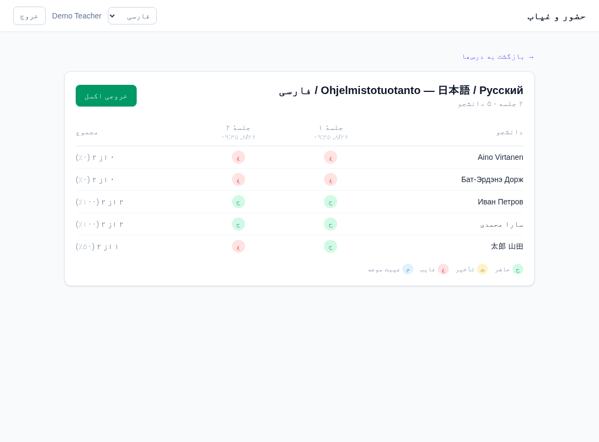
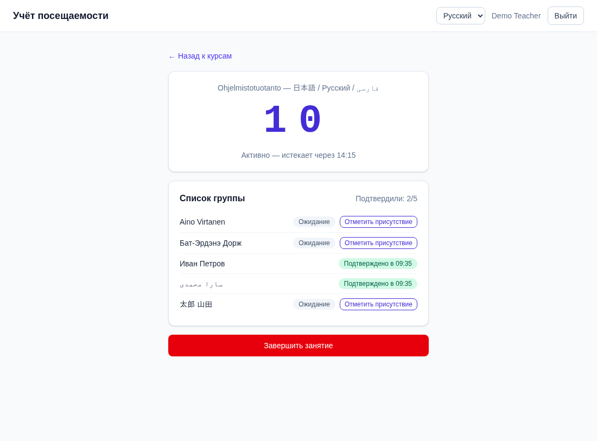

# Database localization: plan and implementation report (Sprint 6)

## 1. Goal

The UI was localized in Sprint 5 (six languages, see [`client/LOCALIZATION.md`](../client/LOCALIZATION.md)).
This sprint extends localization to the data layer:

- The database must store and return text in every supported script: Latin with diacritics (fi),
  Arabic script, right to left (fa), Kanji and kana (ja), and Cyrillic (ru, mn).
- Content that people read in the UI (course names and descriptions, session topics, status and
  role names) must be storable in several languages and returned in the user's language.
- When a translation is missing, the original text must be shown, never an empty field.

## 2. What the database stores, and how each kind is localized

| Kind of data | Examples | Localized how |
| --- | --- | --- |
| **Fixed codes** (ENUM) | `attendances.status` = `PRESENT`, `users.role` = `TEACHER` | Stored as language-neutral codes. Display labels live in `enum_translations`, one row per code per language. The UI also has the same labels in `locales/*.json` (`status.*`). |
| **Content written by users** | `courses.name`, `courses.description`, `sessions.topic` | The original column keeps the text as typed. Optional rows in `course_translations` / `session_translations` override it for a given language. |
| **Personal data** | `users.first_name`, `last_name`, `email` | Not translated (a name is a name), but must be stored in any script. That is handled by UTF-8 (utf8mb4). |
| **Dates, times, numbers** | `sessions.starts_at`, counts | Stored language-neutral (`DATETIME`, integers). They are formatted in the browser with `Intl.DateTimeFormat` / `Intl.NumberFormat` for the UI language (Solar Hijri calendar and Persian digits in fa). |

## 3. Chosen method: translation tables with fallback

We compared three common designs:

| Method | Description | Why we did / didn't choose it |
| --- | --- | --- |
| Column per language (`name_en`, `name_fi`, ...) | One column per language in the same table | Needs a schema change for every new language, and makes wide, mostly-empty tables. Rejected. |
| JSON column (`name = {"en": ..., "fi": ...}`) | All languages in one JSON value | No foreign keys or per-language constraints, and harder to query and index in MariaDB. Rejected. |
| **Translation table per entity** | `course_translations(course_id, lang_code, name, ...)` | **Chosen.** Normalized (3NF), adding a language is just an `INSERT` into `languages`, foreign keys keep it consistent, and existing tables and backend queries stay unchanged. |

The design is additive: [`database_localization.sql`](../database_localization.sql) creates new
tables and views only. `attendance_tracker_v2.sql` and every backend query work exactly as before,
so it can be deployed independently of backend changes.

### 3.1 Schema (see the [ER diagram](diagrams/er-diagram.png))

```
languages            (lang_code PK, native_name, english_name, text_direction LTR|RTL,
                      collation_name, is_default, sort_order)
course_translations  (course_id FK, lang_code FK, name, description)       PK (course_id, lang_code)
session_translations (session_id FK, lang_code FK, topic)                  PK (session_id, lang_code)
enum_translations    (enum_type, enum_value, lang_code FK, label, short_label)
                                                       PK (enum_type, enum_value, lang_code)
```

- `lang_code` uses the same BCP 47 codes as the frontend (`en fi fa ja ru mn`), so the UI language
  maps 1:1 to a row.
- `text_direction` lets a client that reads only database data lay out RTL text (fa) correctly.
- `collation_name` records which collation sorts that language correctly (see 4.3).
- Exactly one language has `is_default = TRUE` (English). It is the fallback for ENUM labels.
- Translation rows are deleted together with their course/session (`ON DELETE CASCADE`).

### 3.2 Retrieval and fallback

Three views return every row in every language, falling back to the original text:

```sql
-- course names in the user's language
SELECT course_id, name, description, is_translated
FROM v_courses_i18n
WHERE lang_code = ? AND teacher_id = ?;

-- inside the view:  COALESCE(course_translations.name, courses.name) AS name
```

| View | Fallback order |
| --- | --- |
| `v_courses_i18n` | translation in that language → original `courses.name` / `description` |
| `v_sessions_i18n` | translation → original `sessions.topic` |
| `v_attendance_i18n` | label in that language → label in the default language → the raw ENUM code |

`is_translated` tells the caller whether a translation was found, for example to mark text that
was not translated.

### 3.3 How the language reaches the database

1. The user picks a language in the UI (or the browser language is used). See `client/js/i18n.js`.
2. `client/js/api.js` now sends it on every request as `Accept-Language: fi, en;q=0.5`.
   `Accept-Language` is a CORS-safelisted header, so this needs no backend or CORS change. We
   checked that the backend's preflight answer allows it.
3. A backend endpoint that wants localized content takes the first supported tag from the header
   and binds it to `WHERE lang_code = ?` on the views above. This step is planned for the backend
   team. This sprint's changes were limited to the database and the client, and the existing
   endpoints keep returning the original text. Status labels are already translated in the
   client from the language-neutral codes the API returns.

## 4. Character encoding and locale configuration

### 4.1 UTF-8 everywhere (`utf8mb4`)

| Layer | Setting |
| --- | --- |
| Server | `docker-compose.yml`: `--character-set-server=utf8mb4 --collation-server=utf8mb4_unicode_ci` |
| Database | `CREATE DATABASE ... CHARACTER SET utf8mb4 COLLATE utf8mb4_unicode_ci` (`attendance_tracker_v2.sql`) |
| Tables | every table `DEFAULT CHARSET=utf8mb4 COLLATE=utf8mb4_unicode_ci` |
| SQL scripts | `SET NAMES utf8mb4` at the top of `database_localization.sql` and `demo_data.sql`, so the `mariadb` command-line client cannot mangle literals |
| JDBC | MariaDB Connector/J 3.x always uses utf8mb4. No URL parameter is needed |
| HTTP / browser | Javalin sends JSON as UTF-8, `index.html` has `<meta charset="utf-8">`, and `fetch().json()` decodes UTF-8 |

`utf8mb4` is required, not MariaDB's legacy `utf8` (= `utf8mb3`). That one stores at most 3 bytes
per character and cannot store emoji or rarer CJK characters (check V5 below).

### 4.2 Fixed-length limits are in characters

`VARCHAR(160)` holds 160 *characters* in utf8mb4, whatever the script. A Japanese course name uses 3
bytes per character, but the 160-character limit the backend checks still holds (check V4).

### 4.3 Sorting (collation) per locale

The default `utf8mb4_unicode_ci` sorts Ä and Ö as A and O. Finnish puts them after Z. `languages.collation_name`
stores the right collation per language (`utf8mb4_swedish_ci` for fi, `utf8mb4_persian_ci` for fa),
to be used as `ORDER BY name COLLATE <collation_name>` (check V12).

## 5. Implementation

| File | Change |
| --- | --- |
| [`database_localization.sql`](../database_localization.sql) | New: `languages`, the three translation tables, the three views, and labels for all ENUM values in six languages. Also sample translations of the sample courses and session topics. Some are left out on purpose to exercise the fallback. |
| [`docker-compose.yml`](../docker-compose.yml) | Server charset/collation flags. Loads `database_localization.sql` after the schema and before the demo data. |
| [`demo_data.sql`](../demo_data.sql) | `SET NAMES utf8mb4`. Four demo students with Cyrillic, Japanese and Persian names, to check display end to end. |
| [`client/js/api.js`](../client/js/api.js) | Sends `Accept-Language` with the UI language. |
| [`docs/database-localization-validation.sql`](database-localization-validation.sql) | Validation queries V1–V12. |
| [`docs/diagrams/er-diagram.png`](diagrams/er-diagram.png) | ER diagram including the localization tables. |

To apply it to an existing database: `mariadb attendance_tracker < database_localization.sql`.
The script can be re-run and drops only its own objects. With Docker it runs automatically on a
fresh volume (`docker compose down -v && docker compose up -d --build`).

## 6. Validation results

Run on 2026-11-17 against MariaDB 13.0.2 (server started with the same flags as in compose),
after loading `attendance_tracker_v2.sql`, `database_localization.sql` and `demo_data.sql`:

```
mariadb --default-character-set=utf8mb4 -t attendance_tracker < docs/database-localization-validation.sql
```

| Check | Result |
| --- | --- |
| V1 connection charset | client / connection / results = `utf8mb4`, collation `utf8mb4_unicode_ci` ✅ |
| V2 database charset | `utf8mb4` / `utf8mb4_unicode_ci` ✅ |
| V3 columns not in utf8mb4 | 0 rows ✅ |
| V4 multi-byte storage | en 30 chars / 30 bytes · fa 24 / 46 · ja 15 / 43 · mn 26 / 48 · ru 25 / 45 ✅ |
| V5 4-byte characters | `✅📚` → 2 chars, 7 bytes, hex `E29C85 F09F939A` ✅ |
| V6 course 3 in every language | en/ja/ru translated; fi/fa/mn fall back to "Web-palvelinohjelmointi" with `is_translated = 0`, fa reported as RTL ✅ |
| V7 coverage | en 3/3 courses 5/5 sessions · ja 3/3, 2/5 · ru 3/3, 1/5 · fa 2/3, 1/5 · mn 2/3, 1/5 · fi 0 (the originals are Finnish) ✅ |
| V8 ENUM values missing a label | 0 rows ✅ |
| V9 status labels | fa: حاضر / غیبت موجه (short ح / م) · ja: 出席 / 公欠 (short 出 / 公) ✅ |
| V10 default languages | 1 ✅ |
| V11 search non-Latin names | `Петр` → Иван Петров · `山田` → 太郎 山田 · `محمد` → سارا محمدی ✅ |
| V12 locale sorting | unicode_ci: Ahonen < Äijälä < Öhman < Zetterberg · swedish_ci (fi): Ahonen < Zetterberg < Äijälä < Öhman ✅ |

### 6.1 End-to-end check through the application

The unchanged backend (`attendance-tracker-server.jar`) was run against the same database:

- Registering the teacher `مریم رضایی` stored `first_name` as `D985D8B1DB8CD985` (correct UTF-8 for مریم) and returned it
  unchanged in the JSON response.
- `GET /api/students?q=Петр` returned Иван Петров. The backend's `LIKE` search works with Cyrillic.
- `POST /api/courses` with the name `データベース入門 — Käyttöliittymät ✅` stored 28 characters / 51 bytes
  and `GET /api/courses` returned it byte for byte.
- A course with mixed-script students was opened in a headless Chromium in fa, ja, ru, mn and fi. Names in
  every script, RTL mirroring, Persian digits and localized status badges all displayed correctly,
  with no console errors. Screenshots: [`docs/screenshots/`](screenshots/).

| fa (RTL) attendance table | ru session view |
| --- | --- |
|  |  |

## 7. Findings and follow-ups

1. **Name order.** The backend joins `first_name + " " + last_name`, so 山田 太郎 is shown as "太郎 山田".
   Japanese (and Mongolian in formal use) put the family name first. Recommendation: format names per
   locale in the client, or store a `display_name`.
2. **Backend use of the views.** Endpoints should read course names from `v_courses_i18n` using the
   `Accept-Language` header the client already sends (section 3.3).
3. **Excel export** is generated by the server in English (headers and status words). With
   `enum_translations` the server can label the sheet in the requester's language.
4. **Translation quality.** The fa/ja/ru/mn database translations are first drafts, like the UI
   ones, and should be reviewed by native speakers.
5. **Test schema.** `server/src/test/resources/schema.sql` (H2) does not include the localization tables
   yet. Add them when the backend starts querying them.
